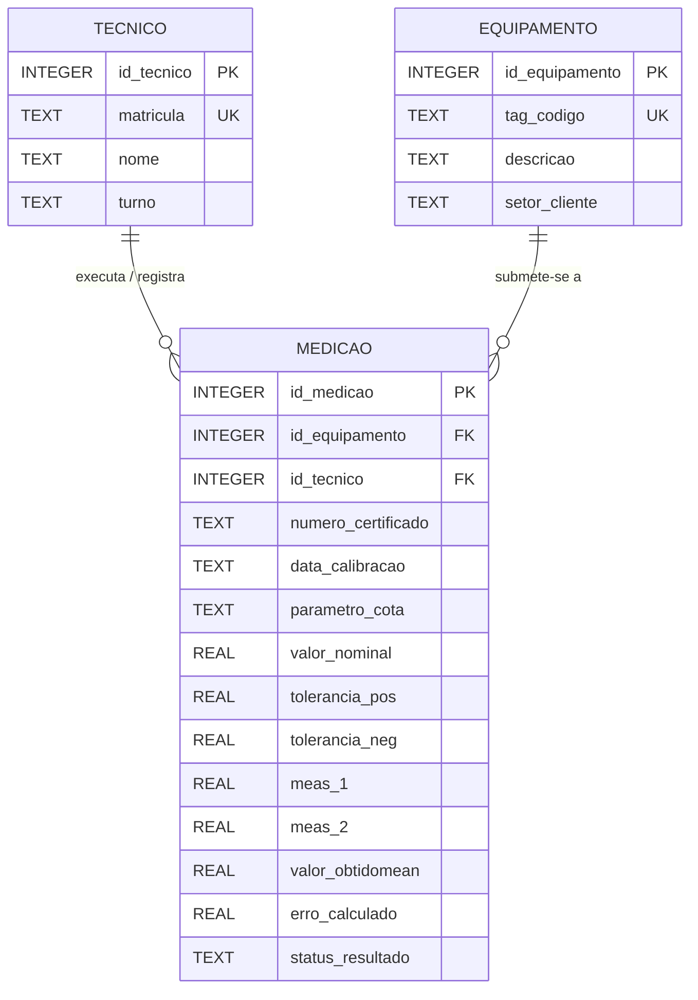

# 1. Estrutura e Organização do Banco de Dados Relacional - Schulz S.A.

## 1.1 Visão Geral do Modelo Conceitual Simplificado
Para atender às demandas operacionais do laboratório de metrologia da Schulz S.A. e substituir a arquitetura atual baseada em planilhas Excel soltas — altamente vulnerável a falhas de digitação, perdas de histórico e erros de cálculo —, o banco de dados foi projetado sob o padrão relacional utilizando o SGBD SQLite.

A escolha dessa estrutura visa garantir os princípios ACID (Atomicidade, Consistência, Isolamento e Durabilidade), fundamentais para a rastreabilidade exigida por normas internacionais de qualidade automotiva e industrial, como ISO 9001, IATF 16949 e ISO/IEC 17025.

O modelo conceitual isola e divide o domínio do problema do laboratório em três entidades centrais perfeitamente delimitadas e normalizadas:

1. **Técnico / Solicitante (`tecnico`):** 
*Papel no Sistema:* Entidade responsável pelo controle de acessos e pela atribuição da autoria operacional sobre os ensaios realizados na MMC Zeiss Contura G2.

*Escopo dos Dados:* Armazena os dados cadastrais permanentes dos metrologistas e operadores (como matrícula única, nome completo e turno de trabalho).

*Propósito:* Permite auditar com precisão quem executou e registrou cada calibração (ex: Cleocir no 1º turno ou José Alcides no 2º turno), eliminando o anonimato ou a ambiguidade nos laudos e atendendo às exigências da gestão de calibração.

2. **Equipamento / Ativo (`equipamento`):** 
*Papel no Sistema:* Entidade que representa os dispositivos físicos de controle, calibradores, blocos-padrão e ferramentas submetidas à medição no laboratório.

*Escopo dos Dados:* Centraliza o cadastro técnico dos ativos (como a TAG/código de identificação do ativo, descrição detalhada da peça e o setor cliente interno solicitante, como a Usinagem I ou Compressores).

*Propósito:* Mantém o histórico completo do ciclo de vida dimensional do equipamento ao longo de sucessivas calibrações, sem a necessidade de duplicar suas especificações cadastrais a cada nova inspeção.

3. **Medição / Ensaio (`medicao`):** 
*Papel no Sistema:* Entidade transacional central (tabela fato) que consolida os eventos de calibração e os resultados metrológicos obtidos.

*Escopo dos Dados:* Armazena as variáveis dinâmicas coletadas na máquina de medir por coordenadas (CMM), incluindo número do certificado, data da medição, identificação da cota/parâmetro inspecionado, valores nominais de engenharia, limites de tolerância superior e inferior, leituras brutas (meas_1 e meas_2), média calculada (valor_obtidomean), erro dimensional apurado e a decisão automatizada de conformidade (APROVADO ou REPROVADO).

*Propósito:* Estabelecer a ponte relacional entre o Agente Executante (tecnico) e o Objeto Inspecionado (equipamento), registrando com precisão milimétrica a conformidade das peças antes de sua liberação para as linhas de montagem da Schulz S.A.

---

## 1.2 Diagrama de Relacionamento de Entidades (Mermaid ERD)




## 1.3 Justificativa Metodológica: Importância de Evitar Dados Duplicados
No modelo anterior baseado em planilhas Excel soltas, dados cadastrais como o nome do metrologista, a descrição do ativo e os limites de tolerância do dispositivo eram repetidos manualmente a cada nova linha de calibração emitida. Essa duplicação trazia problemas operacionais para a Schulz S.A.:Inconsistência de Dados e Erros de Transcrição: Digitações divergentes de uma mesma TAG ou nome de operador corrompiam o histórico de manutenção do ativo.Anomalias de Atualização: Caso o setor de um dispositivo mudasse, era necessário alterar dezenas de planilhas antigas individualmente.Redundância e Desperdício de Armazenamento: A repetição contínua de textos longos em todas as linhas de medição gerava arquivos pesados e propensos a corrupção de fórmulas.Com a normalização implementada no SQLite, as informações de Técnicos e Equipamentos são cadastradas uma única vez em suas respectivas tabelas centrais. A tabela de Medição estabelece um relacionamento N-para-1 (N:1) apontando para os registros originais por meio de Chaves Estrangeiras (FK). Isso garante a rastreabilidade total exigida pelas normas ISO 9001 e IATF 16949, mantendo a integridade referencial do sistema.


<!-- Como o Markdown funciona 
Quando se escreve um arquivo .md, usa-se códigos de texto para indicar o estilo:

Títulos e Seções:
Digitando # Título, tem-se um título grande ((H1) - em linguagem HTML).

Digitando ## Subtítulo, tem-se um sub-título ((H2) - em linguagem HTML).

Estilo de Texto:
Colocando **texto texto texto**, fica em negrito.

Colocando *texto texto texto*, fica em itálico.

Listas e Tabelas:

O uso de traços - Item cria uma lista com marcadores (bullet points).

O uso de barras verticais | Coluna 1 | Coluna 2 | cria uma tabela organizada visualmente.

Blocos de Código e Diagramas:

O uso de três crases ```mermaid indica para o VS Code ou GitHub que aquele bloco não é texto comum, mas sim um diagrama visual que deve ser desenhado na tela.

O uso de: //--o{ } 

TECNICO ||--o{ MEDICAO : "executa / registra"
=> Tradução: Um Técnico pode executar/registrar nenhuma ou várias (0 ou N) Medições, mas cada Medição é executada por um e apenas um (1:1) Técnico.

EQUIPAMENTO ||--o{ MEDICAO : "submete-se a"
=> Tradução: Um Equipamento pode se submeter a nenhuma ou várias (0 ou N) Medições ao longo do tempo, mas cada registro de Medição pertence a um e apenas um (1:1) Equipamento específico.

Entendendo os Símbolos (Cardinalidade)
No diagrama Mermaid, esses símbolos definem a cardinalidade (a quantidade mínima e máxima de conexões entre dois lados):

|| (Barras duplas): Significa "Um e apenas um" (Obrigatório). Fica no lado forte da relação.

o{ (Círculo com Pé de Galinha): Significa "Zero ou Muitos" (Opcional/Múltiplo). Fica no lado "N" da relação.

-- (Linha contínua): Representa a linha de conexão do relacionamento. -->